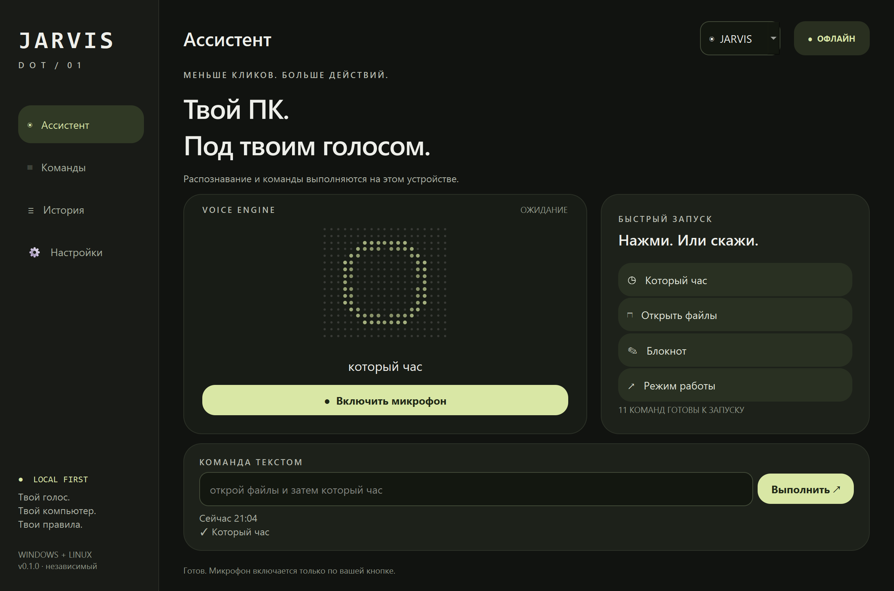
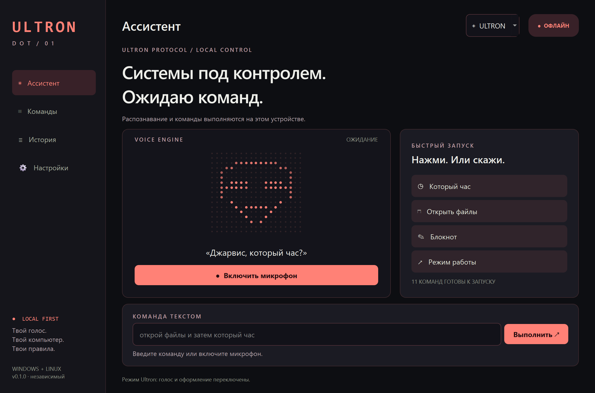

# JARVIS DOT

**Нативный независимый офлайн-помощник для Windows и Linux.**

Nothing OS + Material You: точечная анимация, тёмные поверхности, крупные элементы и четыре цветовых акцента. Настоящее Qt-приложение: без Electron, WebView, браузера, аккаунта или облачного API.





[Смотреть ролик: 56 секунд, 1920×1080, русская озвучка](docs/video/JarvisDot-Demo.mp4)

## Возможности

- Русское распознавание речи на устройстве — Vosk. Микрофон включается кнопкой; по умолчанию нужна фраза «Джарвис».
- 11 стартовых команд: время, файлы, блокнот, громкость, плеер, режим работы, блокировка.
- Редактор сценариев: приложения с отдельными путями для Windows/Linux, папки, сайты, звук, паузы, озвучивание, заметки, блокировка.
- Цепочки: «Джарвис, открой файлы и затем который час». Вся фраза должна соответствовать известным командам.
- Текстовый ввод и кнопки работают без микрофона.
- Трей, выбор микрофона, пользовательское имя, история последних 100 запусков, импорт/экспорт JSON.
- Подтверждение перед блокировкой и любыми сценариями с включённым подтверждением. Импортированные команды выключены до проверки.
- Режимы **Jarvis / Ultron** одновременно переключают голос и весь дизайн. Jarvis: Material You, мягкие поверхности и световой круг. Ultron: графит, красные акценты, угловатые панели и точечная маска. Переключатель в верхней панели.
- Мужской русский нейроголос Piper, локальное изменение высоты и тембра; у Ultron металлические отражения. Кнопка предпрослушивания в настройках.
- Оригинальные короткие ответы из предоставленного владельцем Jarvis Sound Pack: воспроизводятся без изменения голоса в режиме Jarvis. Ultron применяет обработку к тем же записям.
- Дополнительный локальный перенос тембра из образца пака на новые фразы. Работает отдельным процессом, результаты кешируются; установка описана ниже.
- Входящий звук не записывается на диск. Ответы синтезируются во временные WAV и удаляются после воспроизведения. Нет телеметрии и фоновых сетевых запросов. Сайты, открытые по команде, используют интернет в браузере.

Это версия управления ПК и сценариев. Свободный разговор с LLM, анализ экрана, диктовка произвольных заметок и запись макросов пока не реализованы. Два голосовых режима вдохновлены русскими киношными образами, но не являются копиями актёров дубляжа. Послушать: [Jarvis](docs/audio/jarvis.wav), [Ultron](docs/audio/ultron.wav). Без нейромодели используется системный TTS, без обработки персонажа.

## Готовые сборки

Готовые архивы **с включёнными русскими моделями распознавания и синтеза** публикуются в [Releases](https://github.com/shidikusik/jarvis-dot/releases):

- **Windows x64:** распаковать весь `JarvisDot-Windows-x64.zip`, открыть `JarvisDot/JarvisDot.exe`.
- **Linux x64:** распаковать `JarvisDot-Linux-x64.tar.gz`, запустить `./JarvisDot/start.sh`.

Готовые сборки не требуют Python. Не перемещайте `.exe` / бинарник отдельно от папки `_internal`. Без цифровой подписи Windows может показать SmartScreen.

Требования: Windows 10/11 x64; Linux x64 с glibc ≥ 2.34, графической сессией и библиотеками Qt/X11/Wayland. Linux-сборка создаётся на Ubuntu 22.04; исходники предназначены для современных glibc-дистрибутивов, включая Fedora, Debian, Ubuntu, Mint и Arch. Старые glibc, Alpine/musl и ARM не входят в проверенную готовую сборку. «Любой Linux» буквально не гарантируется.

## Запуск из исходников

Python 3.11–3.13 (CI: 3.12). Первичная установка зависимостей и модели требует сети; дальнейшая работа — офлайн. Можно перенести распакованную модель вручную.

### Windows

1. Установить Python с python.org и включить «Add Python to PATH».
2. Открыть `setup-windows.cmd` и дождаться завершения.
3. Запускать `start-windows.cmd`.

### Linux

Установите Python, `venv`, PortAudio, eSpeak NG, поддержку Qt и инструменты управления звуком вашей ОС. Например:

```sh
# Debian / Ubuntu / Mint
sudo apt install python3-venv libportaudio2 espeak-ng libespeak1 \
  libegl1 libgl1 libxcb-cursor0 libxkbcommon-x11-0 libxcb-icccm4 \
  libxcb-image0 libxcb-keysyms1 libxcb-render-util0 libxcb-xinput0 \
  libxcb-shape0 libxcb-xfixes0 libxcb-randr0 libxcb-sync1 playerctl pulseaudio-utils

# Fedora
sudo dnf install python3 portaudio espeak-ng libglvnd-egl libglvnd-glx \
  xcb-util-cursor libxkbcommon-x11 xcb-util-wm xcb-util-image \
  xcb-util-keysyms xcb-util-renderutil playerctl pulseaudio-utils

# Arch
sudo pacman -S python python-pip portaudio espeak-ng libglvnd \
  xcb-util-cursor libxkbcommon-x11 xcb-util-wm xcb-util-image \
  xcb-util-keysyms xcb-util-renderutil playerctl libpulse

sh setup-linux.sh
sh start-linux.sh
```

На Wayland приложение не имитирует глобальные клики/клавиши. Звук управляется через `wpctl` или `pactl`, плееры — через `playerctl`/MPRIS. Блокировка требует работающего `loginctl` и поддержки графической сессии. Трей зависит от оболочки; без трея закрытие завершает программу. Если текстовый редактор не найден, укажите установленный редактор в команде «Открыть блокнот».

## Первый запуск

1. Нажмите «Который час» — команда выполняется сразу.
2. Нажмите «Включить микрофон» и скажите: **«Джарвис, который час»**.
3. В «Командах» создайте свой сценарий. Пути приложений задаются отдельно для каждой ОС.
4. В «Настройках» выберите микрофон, имя, режим Jarvis/Ultron и цвет. Нейроголос встроен в готовые сборки и не зависит от установленного системного голоса.

Имя активации по умолчанию — «Джарвис» в обоих режимах; переключение характера не меняет ваши фразы. Редкие пользовательские имена маленькая модель может распознавать неточно. Если меняете имя, сначала проверьте его в строке распознавания.

Модель: `vosk-model-small-ru-0.22` (~45 МБ). Если она отсутствует, выберите распакованную папку в настройках или нажмите «Скачать модель». Загрузка проверяет SHA-256, путь распаковки и размер архива.

## Локальные данные

- Windows: `%LOCALAPPDATA%\JarvisDot`
- Linux: `$XDG_DATA_HOME/jarvis-dot` или `~/.local/share/jarvis-dot`

Внутри: `settings.json`, `commands.json`, `history.json`, `notes/`, загруженные модели. История содержит фразы и результат запуска, без аудио. Настройки сохраняются атомарно. Некорректный JSON не перезаписывается автоматически.

## Голос из пака и новые фразы

Встроенные записи «К вашим услугам, сэр», «Запрос выполнен, сэр» и другие проигрываются напрямую. Произвольные новые фразы по умолчанию синтезирует быстрый Piper.

Для переноса тембра на новые фразы используется отдельный локальный Chatterbox Voice Conversion: Piper создаёт произношение, Chatterbox переносит тембр из `assets/jarvis_pack/reference.wav`. Это приближение голоса по короткому образцу, а не гарантия идентичной актёрской подачи. В Ultron дополнительно применяются понижение и металлическая обработка.

Подготовка движка: `python scripts/setup_voice_clone.py`. Затем в «Настройках» включить перенос голоса, указать Python из `.voice-venv` и папку `models/clone`, сохранить. Первичная загрузка зависимостей и весов требует сети; генерация выполняется с `HF_HUB_OFFLINE=1` и не отправляет записи в сеть. CPU поддерживается; CUDA можно установить отдельно для NVIDIA. Движок переноса не включён в маленький базовый архив из-за размера весов и PyTorch.

Ответы хранятся в локальном `voice_cache/` (до 200 WAV). При отключённом переносе используется Piper. При включённом переносе ошибка движка отображается явно; приложение не выдаёт другой голос за клон.

Проверенный CPU-пример: [новая фраза с переносом голоса из пака](docs/audio/jarvis-clone.wav), [Ultron с обработкой](docs/audio/ultron-clone.wav). Первая генерация тестовой фразы на CPU заняла около 50 секунд; кешированные ответы и оригинальные записи воспроизводятся сразу. Во время генерации микрофон продолжает принимать команды; подавление обратной связи включается только при воспроизведении.

## Разработка и сборка

```sh
python -m pip install -r requirements-dev.txt
python -m pytest -q
python -m jarvis --smoke-test --screenshot docs/screenshots/assistant.png
python scripts/download_model.py
python scripts/download_voices.py
python scripts/check_speech.py
python scripts/build.py --with-model
```

Сборка выполняется на целевой ОС. GitHub Actions тестирует Windows и Linux, рендерит Qt-интерфейс, проверяет упакованное приложение и публикует архивы на тег `v*`. Исходники и коммиты принадлежат `shidikusik`; workflow не коммитит файлы от ботов.

## Проверки и ограничения

Автотесты проверяют точное сопоставление фраз, обязательность имени, цепочки, подтверждение, отключённые команды, отмену сценария, сохранение заметок, запрет shell-запуска, хранение и защиту распаковки. GUI smoke-test запускает настоящее Qt-окно и выполняет локальную команду. Проверка Vosk использует синтезированный русский WAV. Это не заменяет ручной тест вашего микрофона, акустики, системного голоса и всех desktop-окружений.

Лицензия исходников: MIT. Лицензии зависимостей и модели: [THIRD_PARTY.md](THIRD_PARTY.md).
